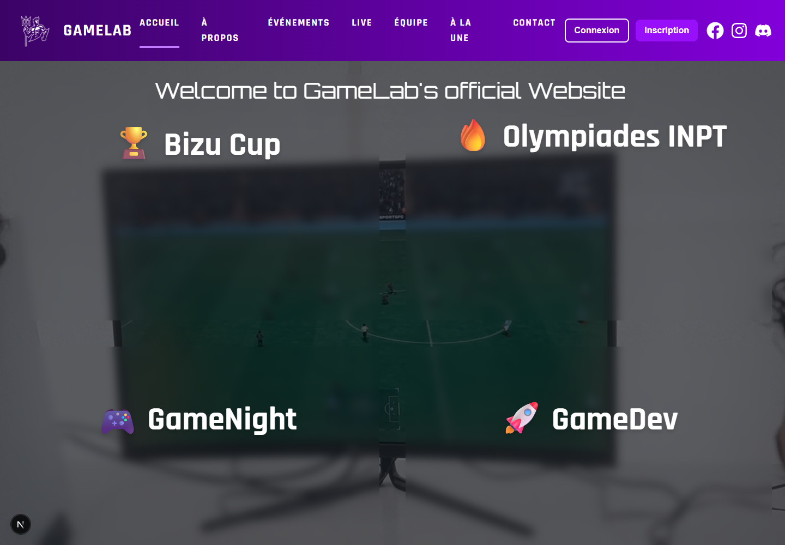

# GameLab INPT — Plateforme web du club gaming

Application full stack pour présenter le club, ses événements et permettre aux membres de créer un compte et de s'inscrire aux événements.

## Aperçu


## Fonctionnalités présentes dans le code
- Pages du club, équipe, galerie, événements et streaming.
- Inscription, connexion et profil utilisateur avec authentification JWT.
- Liste et détail des événements ; inscription et désinscription.
- Contrôle des doubles inscriptions et de la capacité des événements.
- Tests frontend Jest/Testing Library et backend Pytest.

## Stack et architecture
Next.js / React / TypeScript → API FastAPI → SQLite via SQLAlchemy.
Le dépôt contient les Dockerfiles, un fichier Compose et des diagrammes PlantUML dans `docs/uml/`.

## Lancement local
Prérequis : Node.js 20.9+ et Python 3.11.

```bash
git clone https://github.com/KSSIRI05/gamelab-fullstack.git
cd gamelab-fullstack
npm ci
```

Créer `.env.local` à la racine :
```env
NEXT_PUBLIC_API_URL=http://localhost:8000
```

Dans un terminal backend :
```bash
cd backend
python -m venv .venv
# Windows : .venv\Scripts\activate
# Linux/macOS : source .venv/bin/activate
pip install -r requirements.txt
```

Créer `backend/.env` avec une clé JWT aléatoire :
```env
DATABASE_URL=sqlite:///./gamelab.db
SECRET_KEY=remplacer-par-une-cle-aleatoire
ALLOWED_ORIGINS=http://localhost:3000
```

```bash
uvicorn main:app --reload --port 8000
```

Les tables sont créées au démarrage. Dans un second terminal à la racine :
```bash
npm run dev
```
Frontend : http://localhost:3000 ; documentation API : http://localhost:8000/docs.
Les routes métier utilisent les préfixes `/api/auth` et `/api/events`.

## Tests et intégration continue
```bash
npm test -- --runInBand
cd backend
pytest tests/ -v
```
GitHub Actions exécute les tests puis construit et publie les images Docker lors des pushes sur `main` ou `ci`. La publication nécessite les secrets `DOCKER_USERNAME` et `DOCKER_PASSWORD`. Ce workflow ne déploie pas automatiquement un serveur.

## Conteneurisation
Le fichier est situé dans `docker/docker-compose.yml`. Avant utilisation, vérifier les montages backend : la configuration actuelle monte deux volumes sur `/app`, ce qui peut masquer les fichiers de l'image. Le lancement local ci-dessus constitue la procédure documentée pour le développement.

## Structure
`app/` : frontend ; `lib/api.ts` : client HTTP ; `backend/app/` : modèles, routes et schémas ; `backend/tests/` et `tests/` : tests ; `docker/` : conteneurs ; `docs/uml/` : conception.
