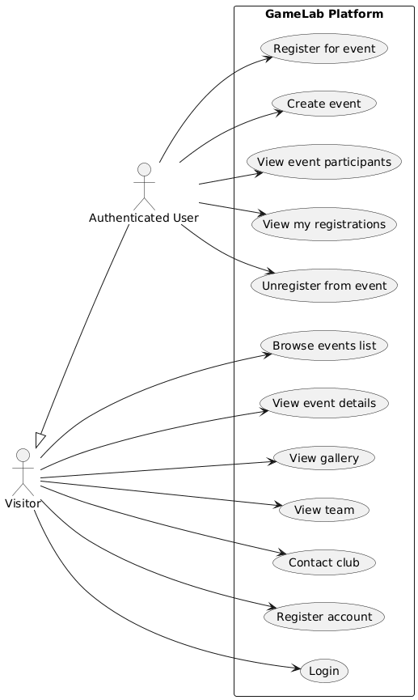
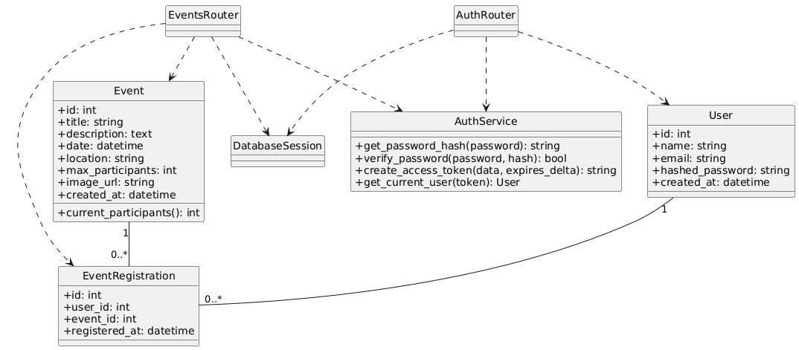
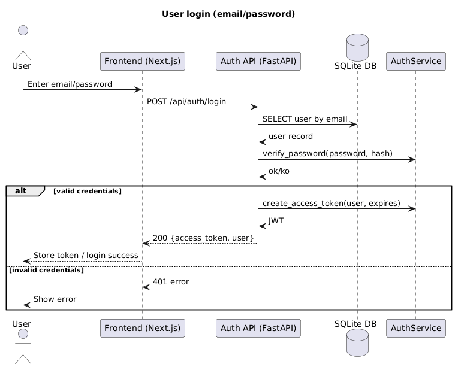
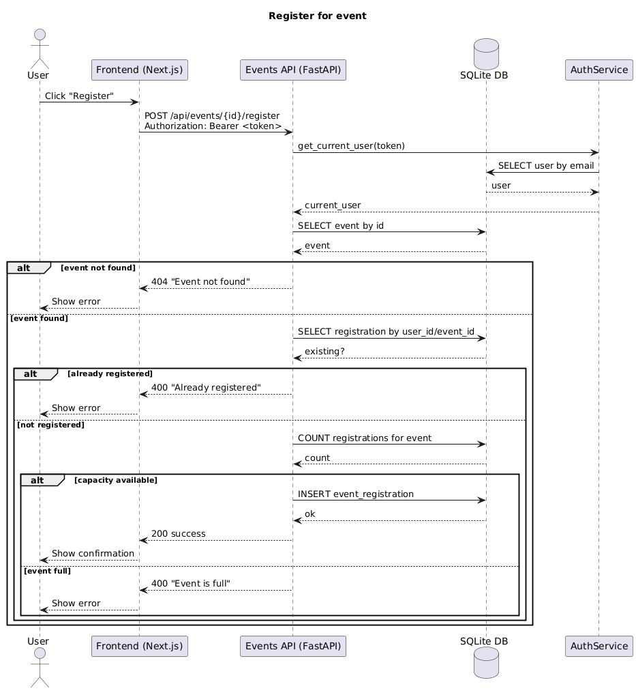

# 🎮 GameLab INPT - Club de Jeux Vidéo

Bienvenue dans le projet web du club gaming **GameLab INPT**! Site officiel et plateforme d'événements pour les passionnés de jeux vidéo.

## Rapport du projet 


Images Docker:
- abdouhad/gamelab-frontend:latest
- abdouhad/gamelab-backend:latest

## 📝 Description

GameLab est une application fullstack moderne pour:
- ✨ Préenter le club et ses événements
- 🎮 Gérer les inscriptions aux événements
- 👥 Afficher l'équipe dirigeante
- 📸 Galerie photo des événements passés
- 🔐 Authentification des utilisateurs

## 🛠 Stack Technologique

### Frontend
- **Framework**: Next.js 16 (React 19)
- **Styling**: Tailwind CSS 4 + PostCSS
- **Animations**: Framer Motion
- **Icons**: React Icons
- **Testing**: Jest + React Testing Library
- **Language**: TypeScript

### Backend
- **Framework**: FastAPI (Python 3.11)
- **Base de données**: SQLite avec SQLAlchemy ORM
- **Auth**: JWT (JSON Web Tokens)
- **Validation**: Pydantic
- **Testing**: Pytest

### DevOps
- **Containerization**: Docker & Docker Compose
- **Environment Management**: Environment variables (.env)

## 🚀 Démarrage Rapide

### Sans Docker

```bash
# Frontend (Terminal 1)
npm install
npm run dev

# Backend (Terminal 2)
cd backend
pip install -r requirements.txt
python main.py
```

Puis accédez à:
- Frontend: http://localhost:3000
- Backend API: http://localhost:8000
- API Docs: http://localhost:8000/docs

### Avec Docker

```bash
docker-compose up --build
```

Pour plus de détails, voir [docker/README.md](docker/README.md) 🐳

## 📂 Structure du Projet

```
.
├── app/                      # Frontend Next.js
│   ├── components/          # Composants réutilisables
│   ├── about/               # Page À propos
│   ├── contact/             # Page Contact
│   ├── events/              # Page Événements
│   ├── evenements/          # Pages événements spécifiques
│   ├── gallery/             # Galerie photo
│   ├── login/               # Page Login
│   ├── signup/              # Page Inscription
│   ├── team/                # Page Équipe
│   ├── context/             # React Context (Auth)
│   ├── layout.tsx           # Layout principal
│   └── page.tsx             # Page d'accueil
│
├── backend/                 # Backend FastAPI
│   ├── app/
│   │   ├── models/         # Modèles SQLAlchemy
│   │   ├── schemas/        # Schémas Pydantic
│   │   ├── routers/        # Routes FastAPI
│   │   ├── utils/          # Utilitaires (auth, etc)
│   │   └── database.py     # Configuration DB
│   ├── tests/              # Tests pytest
│   ├── requirements.txt    # Dépendances Python
│   └── main.py             # Point d'entrée
│
├── public/                  # Assets statiques
├── __tests__/              # Tests Frontend
├── lib/                    # Utilitaires JS
├── types/                  # Types TypeScript
│
├── docker-compose.yml      # Configuration Docker (dev + prod)
├── Dockerfile.backend      # Image Backend
├── Dockerfile.frontend     # Image Frontend
├── .dockerignore          # Fichiers ignorés Docker
├── .env.example           # Template vars dev
├── .env.prod.example      # Template vars prod
│
├── package.json           # Dépendances NPM
├── tsconfig.json          # Config TypeScript
├── tailwind.config.js     # Config Tailwind
├── jest.config.js         # Config Jest
└── README.md              # Ce fichier
```

## UML Modeling

PlantUML source files:
- docs/uml/use-case.puml
- docs/uml/class-diagram.puml
- docs/uml/sequence-login.puml
- docs/uml/sequence-event-registration.puml

Rendered diagrams:





## ⚙️ Configuration

### Variables d'Environnement

Créez un fichier `.env` à la racine:

```bash
cp .env.example .env
```

Voir [.env.example](.env.example) pour tous les paramètres.

## 🧪 Tests

### Frontend
```bash
npm test                 # Tous les tests
npm test -- --watch    # Mode watch
npm run build          # Build de production
```

### Backend
```bash
cd backend
pytest                 # Tous les tests
pytest -v             # Verbose
pytest --cov          # Avec coverage
```

## 📦 Installation des Dépendances

### Frontend
```bash
npm install
```

### Backend
```bash
cd backend
pip install -r requirements.txt
```

## 🎯 Fonctionnalités Principales

### Actuellement Implémentées ✅
- Landing page responsive
- Navigation et menu mobile
- Page d'équipe avec photos
- Page des événements
- Pages événements spécifiques (Bizu Cup, GameDev, GameNight, Olympiades)
- Galerie photo
- Page de contact
- Authentification utilisateur (Login/Signup)

### En Développement 🚧
- Système d'inscription aux événements
- Tableaux de bord utilisateur
- Notification d'événements
- Intégration streaming Twitch

## 👥 Équipe

- **Président**: Taha Ibourk-El-Idrissi
- **Vice-Président**: Mohammed Yassine Lachguer
- **Trésorier**: Mohammed Kssiri
- **Secrétaire Général**: Abderrafia Haddoumi
- **Chef Events**: Ali Hame
- **Chef Media**: Oussama Bourhan-Ed-Dine

## 🔗 Liens Utiles

- 📘 [Facebook](https://www.facebook.com/gamelab.inpt.7)
- 📷 [Instagram](https://www.instagram.com/gamelabinpt/)
- 💬 [Discord](https://discord.gg/kqSCjXQJ)

## 🐳 Docker & Déploiement

Pour la containerisation et le déploiement, consultez [docker/README.md](docker/README.md).

### Quick Commands
```bash
# Développement
docker-compose up --build

# Production
docker-compose --env-file .env.prod up --build

# Pusher sur Docker Hub
docker-compose push
```

## 🔒 Sécurité

- Authentification JWT avec refresh tokens
- CORS configuré pour les domaines approuvés
- Validation des données avec Pydantic
- Hachage des mots de passe (bcrypt)
- Secrets stockés en variables d'environnement

## 📝 Commits

Les commits suivent les conventions [Conventional Commits](https://www.conventionalcommits.org/):

```
feat: ajouter nouvelle fonctionnalité
fix: corriger un bug
docs: mettre à jour la documentation
style: changements de formatage
refactor: refactoriser le code
test: ajouter des tests
chore: tâches de maintenance
```

## 🤝 Contribution

1. Créer une branche `feature/nom-feature`
2. Faire les changements
3. Tester localement
4. Créer un Pull Request
5. Attendre la review et merge

## 📄 Licence

Ce projet est propriétaire du club GameLab INPT.

## 📞 Support

Pour les questions ou problèmes:
- 📧 Email: gamelab@inpt.ac.ma
- 💬 Discord: [Rejoindre le serveur](https://discord.gg/kqSCjXQJ)

---

**Fait avec ❤️ par l'équipe GameLab INPT**
